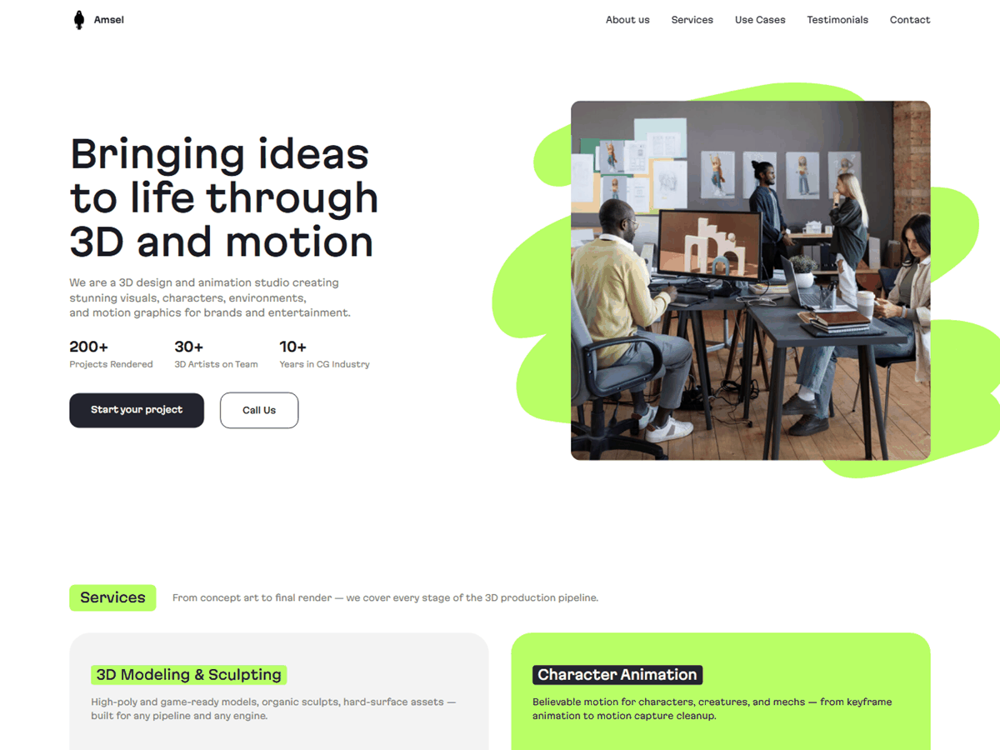

# Amsel

  

A modern, minimalist block theme for agencies and creative studios.

- **WordPress.org:** https://wordpress.org/themes/amsel/
- **Live preview:** https://wp-themes.com/amsel/

## Description

Amsel is a modern, minimalist block theme built for agencies, creative studios, freelancers, and portfolios. Powered by full site editing, it ships with block patterns for the header, footer, and a ready-made front page, plus light and dark style variations, fluid typography, a self-hosted variable font, and rounded, card-based layouts. Templates cover the blog, single posts with related posts and comments, archives, search, and a 404 page. Use the bundled sections — services, portfolio / case studies, testimonials, blog, and contact — as a fast starting point for a studio, agency, or personal site.

## Installation

1. In your WordPress admin, go to Appearance > Themes and click "Add New Theme".
2. Search for "Amsel" and click "Install", then "Activate".
3. Go to Appearance > Editor to customize templates, styles and patterns.

To install the development version from this repository, download it as a ZIP (Code > Download ZIP), rename the folder inside to `amsel` and upload it in Appearance > Themes > Add New Theme > Upload Theme.

## Requirements

- WordPress 6.7 or later
- Tested up to WordPress 7.1
- PHP 8.0 or later

## Changelog and credits

The full changelog, image and font credits with their licenses are listed in [readme.txt](readme.txt).

## License

Amsel is distributed under the terms of the [GNU General Public License v2 or later](https://www.gnu.org/licenses/gpl-2.0.html).

---

More themes by Roman Fink: https://wordpress.org/themes/author/romanfink/
